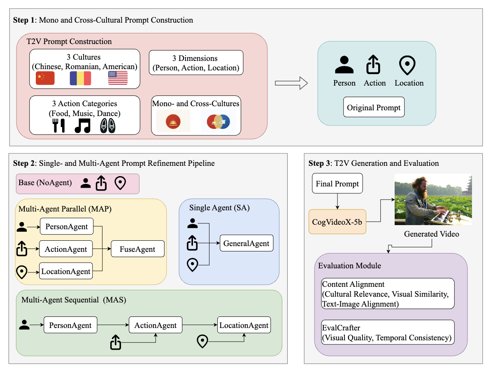

# When Cultures Move: Measuring and Improving Multicultural Text-to-Video Generation

## Overview

This repository accompanies our paper **"When Cultures Move: Measuring and Improving Multicultural Text-to-Video Generation," accepted at the 5th Workshop on NLP for Positive Impact (NLP4PI) at EMNLP 2026**.

We introduce **multicultural text-to-video (T2V) generation** as a task and present a benchmark for evaluating how T2V models represent multiple cultures within a single scene. In particular, we study both mono-cultural scenarios and more challenging cross-cultural scenarios, where the person, action, and location can originate from different cultural backgrounds.

We also explore **MAVEN (Multi-Agent Video Enrichment for cultural Narrative)**, a multi-agent prompt refinement framework that decomposes cultural grounding into person, action, and location dimensions using culturally specialized agents.

This repository contains the dataset, implementation, generation, and evaluation code used in our experiments.

## Problem Statement

Current T2V models face two main challenges:

1. **Limited cross-cultural generation**: Existing benchmarks primarily focus on single-culture scenarios, with limited systematic study of prompts that combine cultural elements from multiple cultures within the same scene.

2. **Cultural fidelity gaps**: T2V models can struggle to accurately represent culturally grounded people, actions, customs, landmarks, and visual details, particularly for underrepresented cultural contexts.

## Approach



Our approach consists of three main steps:

### Step 1: Mono- and Cross-Cultural Prompt Construction

We construct culturally grounded prompts across:

- **3 Cultures**: Chinese, American, Romanian
- **3 Dimensions**: Person, Action, Location
- **3 Action Categories**: Food, Music, Dance
- **27 Cultural Actions**
- **9 Cultural Locations**

We study two scenarios:

- **Mono-cultural**: Person, action, and location all originate from the same culture.
- **Cross-cultural**: Person, action, and location originate from different cultures.

Example:

> "An American person eating dumplings at Bran Castle"

This combines an American person, a Chinese cultural action, and a Romanian location within a single scene.

### Step 2: Multi-Agent Prompt Refinement Pipeline

We design and compare four prompt refinement architectures:

- **Base (No-Agent)**: Uses the original prompt directly without refinement.
- **Single-Agent (SA)**: A single general-purpose agent jointly refines all prompt dimensions.
- **Multi-Agent Sequential (MAS)**: Three culturally specialized agents — PersonAgent, ActionAgent, and LocationAgent — refine the prompt sequentially.
- **Multi-Agent Parallel (MAP)**: Three culturally specialized agents independently refine the person, action, and location dimensions in parallel, after which a FuseAgent combines their outputs into a coherent final prompt.

All agents use the same underlying LLM, allowing us to study the effect of agent structure and specialization under a controlled setting.

### Step 3: T2V Generation and Evaluation

**Video Generation**

Videos are generated using **CogVideoX-5B** with a fixed generation configuration across all pipelines.

**Evaluation**

We evaluate the generated videos across several complementary dimensions:

- **Cultural Relevance**
  - Overall Cultural Relevance Score (OCRS)
  - Person Cultural Relevance Score (PCRS)
  - Action Cultural Relevance Score (ACRS)
  - Location Cultural Relevance Score (LCRS)

- **Visual Similarity**
  - Measures visual changes introduced by prompt refinement.

- **Text-Image Alignment**
  - Measures alignment with both the original and refined prompts.

- **Video Quality**
  - Visual Quality
  - Temporal Consistency

- **VLM-Based Evaluation**
  - Gemini 2.5 Pro is used as a vision-language model judge for cultural relevance, visual similarity, and text-image alignment.

## Key Findings

1. **Parallel multi-agent refinement achieves the strongest cultural relevance.**  
   MAP obtains the highest overall cultural relevance among the evaluated pipelines and provides the most balanced improvement across cultural relevance, visual quality, and temporal consistency.

2. **Cross-cultural generation remains more challenging than mono-cultural generation.**  
   Across pipelines, cross-cultural prompts show approximately a 4–6% decrease in average cultural relevance compared with mono-cultural prompts.

3. **Location-level cultural grounding benefits strongly from specialization.**  
   The largest improvements are observed for location-related cultural relevance, indicating that dedicated cultural specialization can be particularly useful for representing landmarks and environments.

4. **Automatic cultural evaluation remains imperfect.**  
   CLIP-based and VLM-based evaluations show moderate to strong correlation for person, action, and location dimensions, while agreement is substantially weaker for overall cultural relevance.

5. **Structured specialization is promising in our controlled setting.**  
   Using culturally specialized agents for person, action, and location refinement outperforms a single general-purpose refinement agent on cultural relevance under the same underlying model.

## Dataset

Our benchmark contains **243 unique culturally grounded prompts and 972 generated videos**.

It includes:

- **3 cultures**: Chinese, American, Romanian
- **3 cultural dimensions**: Person, Action, Location
- **3 action categories**: Food, Music, Dance
- **27 distinct cultural actions**
- **9 culturally grounded locations**
- **81 mono-cultural prompts**
- **162 cross-cultural prompts**
- **4 generation pipelines**: Base, SA, MAS, MAP
- **972 generated videos**

The dataset is publicly available on Hugging Face:

[https://huggingface.co/datasets/AIM-SCU/MAVEN_Multicultura_Text-to-Video_Generation](https://huggingface.co/datasets/AIM-SCU/MAVEN_Multicultura_Text-to-Video_Generation)

## Paper

**When Cultures Move: Measuring and Improving Multicultural Text-to-Video Generation**

**Shuowei Li, Yuming Zhao, Parth Bhalerao, Oana Ignat**

Accepted at the **5th Workshop on NLP for Positive Impact (NLP4PI), EMNLP 2026**.

- **arXiv**: [https://arxiv.org/abs/2605.16716](https://arxiv.org/abs/2605.16716)
- **Dataset**: [https://huggingface.co/datasets/AIM-SCU/MAVEN_Multicultura_Text-to-Video_Generation](https://huggingface.co/datasets/AIM-SCU/MAVEN_Multicultura_Text-to-Video_Generation)

## Citation

If you find this work helpful, please cite:

```bibtex
@inproceedings{li2026when,
  title     = {When Cultures Move: Measuring and Improving Multicultural Text-to-Video Generation},
  author    = {Li, Shuowei and Zhao, Yuming and Bhalerao, Parth and Ignat, Oana},
  booktitle = {Proceedings of the 5th Workshop on NLP for Positive Impact (NLP4PI)},
  year      = {2026},
  address   = {Budapest, Hungary},
  publisher = {Association for Computational Linguistics},
  url       = {https://arxiv.org/abs/2605.16716}
}
```

## Acknowledgments

We thank the anonymous reviewers for their constructive feedback, and the members of the AIM Lab at Santa Clara University for their support and helpful discussions.
